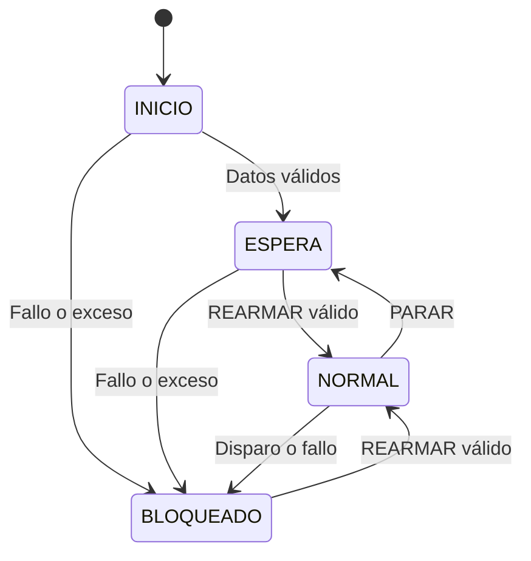

# Etapa 4 · Medición, deslastre y alarmas

Versión integrada del prototipo académico IoT energético. Incluye la adquisición necesaria de la etapa 3 para que el control actúe sobre potencia medida a partir de las señales, además de temperatura. Conserva la maqueta monofásica de 12 VCA y los componentes de la etapa 2.

## Apertura en Wokwi

Extraer el ZIP, crear un proyecto nuevo en https://wokwi.com/projects/new/esp32 y colocar estos **seis archivos en la raíz**, conservando sus nombres:

| Archivo | Cómo cargarlo |
| --- | --- |
| `sketch.ino` | Reemplazar todo el contenido de la pestaña existente. |
| `diagram.json` | Reemplazar todo el contenido de la pestaña existente. |
| `energia_control.h` | Menú de archivos → Upload file(s)… |
| `libraries.txt` | Menú de archivos → Upload file(s)… |
| `medidor-ac.chip.c` | Menú de archivos → Upload file(s)… |
| `medidor-ac.chip.json` | Menú de archivos → Upload file(s)… |

En un proyecto que ya tenga alguno de esos archivos, reemplazar su contenido en lugar de subir un duplicado. La flecha del menú de archivos se encuentra junto a sus pestañas. El README y `verificacion` son documentación y pruebas locales, y no se cargan al simulador.

Iniciar con el botón verde. Esperar **ESPERA**, temperatura válida y `MED=VALIDA`. La carga desconectable permanece abierta al arrancar. Escribir `REARMAR` en el monitor serie y pulsar Enter para habilitarla.

## Reglas implementadas

| Condición | Acción |
| --- | --- |
| P > 1,50 W **o** T > 55 °C | Abrir la rama no prioritaria, encender LED rojo y buzzer de 2 kHz, retener la causa. |
| Dato inválido, saturación, offset incorrecto o muestreo fuera de calidad | Bloquear y activar alarma. |
| Medición eléctrica de más de 300 ms o temperatura de más de 3 s | Bloquear y activar alarma. |
| Contacto NO distinto del mando durante más de 100 ms | Bloquear y registrar CONTACTO. Es supervisión del contacto, no un retardo añadido al disparo. |
| Normalización de la temperatura o potencia | Mantener el bloqueo hasta una orden manual válida. |
| `REARMAR` | Aceptar únicamente con datos válidos y recientes, P < 1,50 W, T < 50 °C y contacto inicialmente abierto. |
| `PARAR` | Ordenar apertura. Desde NORMAL pasa a ESPERA; no borra un bloqueo previo ni silencia su alarma. |
| Cambio del PIR | Informar presencia; conservar prioridades y supervisión. |

La igualdad no dispara por sí sola: P = 1,50 W y T = 55 °C no superan los umbrales. Para rearmar, en cambio, P = 1,50 W o T = 50 °C se rechazan. Las causas se acumulan si coinciden.



La decisión de corte usa la potencia de cada ventana eléctrica. No espera a completar la demanda de diez segundos. La respuesta térmica depende de la próxima conversión válida del DS18B20, solicitado cada segundo y leído sin esperar bloqueado durante la conversión de 12 bits.

## Medición y modelo de señales

Se solicitan **2.000 pares por segundo**, con 200 pares por ventana nominal de 100 ms. Se calculan RMS, potencia activa como media de los productos después de corregir los offsets, potencia aparente y factor de potencia. Se integra la potencia con la duración de cada ventana válida para obtener kWh. La demanda usa los últimos diez segundos válidos consecutivos, ponderados por tiempo, y conserva el máximo de las ventanas completas.

El ESP32 de `diagram.json` utiliza `cpuFrequency: "16"`, que fija el límite de ejecución de instrucciones del simulador en 16 MHz. Wokwi reduce por defecto esa velocidad para ahorrar trabajo de emulación. El ajuste dio al programa margen suficiente para sostener el muestreo sin perder avisos en la sesión comprobada; conserva los tiempos de los periféricos y puede hacer que el reloj simulado avance más despacio respecto al real. Mantener este atributo al importar el circuito.

El monitor muestra `fs`, la frecuencia observada, y `Q`, la calidad. La frecuencia objetivo no sustituye esa comprobación. Si se pierden avisos, la ventana dura fuera de 90–110 ms, la frecuencia queda fuera de 1.800–2.200 Hz o aparece un intervalo mayor de 1.500 µs, se invalida la ventana y el control bloquea. Las tolerancias de tiempo son decisiones del banco de ensayo, no nuevas condiciones de la rúbrica.

El generador representa las salidas acondicionadas del SCT013-000 y ZMPT101B: `VOUT = 1,65 + 0,05·v(t)` e `IOUT = 1,65 + 2·i(t)`. Conserva frecuencia de 60 Hz, rama prioritaria de 220 Ω y rama desconectable inicialmente de 220 Ω. La posición real del contacto virtual COM/NO gobierna la contribución de esa segunda rama.

**Cambio de esta versión:** GPIO14 se conecta a SYNC del chip. Cada cambio de nivel captura y retiene V e I del mismo instante virtual, y luego el ESP32 lee ambos ADC. Esta retención común evita atribuir al consumo un desfase causado por leer secuencialmente dos ondas que cambian durante la lectura. Es un recurso de simulación: no convierte el ADC físico del ESP32 en uno simultáneo ni agrega una compra al proyecto. El modelo sigue comprobando atributos y contactos cada 100 µs; las salidas analógicas se actualizan con las capturas SYNC.

La escala virtual `5/4096 V por cuenta` se basa en los tres puntos comprobados en la etapa 2. El circuito interno y la calibración del SCT, ZMPT y ESP32 físicos no están reproducidos. El desfase configurable es un caso de señales de referencia, diferente de las cargas resistivas a 0°.

| Caso, a 12 V RMS y 0° | Corriente de referencia | Potencia de referencia |
| --- | ---: | ---: |
| Solo rama prioritaria | 0,054545 A | 0,654545 W |
| Ambas ramas de 220 Ω | 0,109091 A | 1,309091 W |
| Rama desconectable de 110 Ω conectada | 0,163636 A | 1,963636 W |

Si la rama desconectable sigue en 110 Ω después de un disparo, un rearme puede volver a conectarla porque la potencia observada con ella abierta es baja. La nueva medición detectará otra vez la sobrecarga y volverá a cortar. Para demostrar una recuperación estable, restablecer primero esa rama a 220 Ω. El control no conoce anticipadamente el consumo de una rama desconectada.

## Pines

| Función | GPIO |
| --- | ---: |
| Tensión, ADC1 | 34 |
| Corriente, ADC1 | 35 |
| DS18B20, 1-Wire con pull-up de 4,7 kΩ | 4 |
| PIR | 27 |
| Relé, HIGH conecta y LOW abre | 26 |
| LED rojo, resistencia de 330 Ω | 33 |
| Buzzer | 25 |
| Supervisión del contacto, con pull-down de 10 kΩ | 32 |
| SYNC del generador virtual | 14 |

COM/NO es un lazo lógico de 3,3 V para esta supervisión. Los 12 VCA y resistencias de carga se representan matemáticamente dentro del chip. Los dos LED verde y azul indican el estado de esas ramas del modelo.

## Prueba manual principal

1. Arrancar con modo del chip **0**, tensión **12**, resistencia desconectable **220 Ω**, desfase **0°** y temperatura **25 °C**. Esperar ESPERA y enviar `REARMAR`: debe pasar a NORMAL, cerrar el contacto y medir aproximadamente 1,31 W.
2. Pulsar el chip y cambiar la resistencia desconectable a **110 Ω**: debe pasar a BLOQUEADO por POTENCIA. El indicador azul se apaga y el verde permanece encendido. La medición posterior debe acercarse a 0,65 W; el valor alto puede durar solo una ventana y quedar registrado por el evento de disparo.
3. Volver a **220 Ω**: debe continuar bloqueado. Enviar `REARMAR`: vuelve a NORMAL.
4. Pulsar el DS18B20 y ajustar a **60 °C**: después de actualizar la conversión debe bloquear por TEMPERATURA.
5. Ajustar a **50 °C**, esperar que el monitor muestre esa lectura e intentar `REARMAR`: debe rechazarlo. Ajustar a **49 °C**, esperar la lectura y rearmar: debe aceptarlo.
6. Pulsar el PIR y **Simulate motion**: cambia PIR, sin anular ni provocar por sí solo el corte.

Consultar `verificacion/RESULTADOS.md` para distinguir lo comprobado automáticamente de lo observado en Wokwi y los casos pendientes de la etapa 5. Los tiempos del monitor pertenecen a la simulación; su velocidad respecto al reloj real depende del navegador.

## Ensayos de fallo y órdenes

| Orden o control | Uso |
| --- | --- |
| `ESTADO` / `AYUDA` | Consultar diagnóstico o instrucciones. |
| `PAUSA_ADC` / `SIGUE_ADC` | Dejar de publicar muestras y reanudar la adquisición; comprueba el vencimiento de 300 ms. |
| `PAUSA_TEMP` / `SIGUE_TEMP` | Dejar de actualizar temperatura y solicitar una conversión nueva; comprueba el vencimiento de 3 s. |
| Chip modo **4** | Llevar tensión analógica a cero: fallo de saturación. |
| Chip modo **5** | Llevar corriente analógica a 5 V virtuales: fallo de saturación. |
| Chip modo **0** | Recuperar las ondas CA; esperar datos válidos y enviar `REARMAR`. |

Los modos DC 1 y 3 también provocan un offset inválido al estar activo el medidor. El modo 2 equivale a ambas señales constantes en su bias: puede representar cero y no basta para diagnosticar una avería. Del mismo modo, no toda desconexión de un sensor analógico puede identificarse únicamente a partir de su amplitud.

Los mandos directos `RELE 1`, `LED 0` y `BUZZER 0` de la etapa 2 se sustituyen por el control automático. Las órdenes de pausa son recursos de ensayo que dejan actuar la supervisión; no suspenden el bloqueo ni fuerzan la reconexión.

La energía acumula solo intervalos medidos válidos. Una pérdida de datos reinicia la ventana de demanda y deja el máximo histórico; no inventa energía para cubrir el hueco. Los contadores `invalidas` y `omitidas`, junto con los segundos válidos, permiten identificar esa cobertura incompleta. Energía y máximo comienzan en cero al reiniciar.

## Repetir las pruebas del núcleo

Con Python, GCC y G++ disponibles, ejecutar desde la carpeta del proyecto:

```sh
python3 verificacion/ejecutar.py
```

Se compilan el modelo C y las pruebas del mismo `energia_control.h` que incluye el ESP32. La salida queda en `verificacion/salida_pruebas.txt`. Incluye umbrales exactos, rearme, datos vencidos, entradas inválidas, contacto, parser serie, medición, energía, demanda y un lazo cerrado con el modelo de cargas. Estas pruebas locales no sustituyen la ejecución del firmware completo en Wokwi ni el ensayo físico.

## Referencias

- Ficha técnica de etapa 1 y plan de desarrollo de la segunda fase del proyecto.
- Espressif, ESP Timer: https://docs.espressif.com/projects/esp-idf/en/stable/esp32/api-reference/system/esp_timer.html
- Espressif, ADC Arduino-ESP32: https://docs.espressif.com/projects/arduino-esp32/en/latest/api/adc.html
- Wokwi, GPIO y captura de cambios: https://docs.wokwi.com/chips-api/gpio
- Wokwi, API analógica: https://docs.wokwi.com/chips-api/analog
- Wokwi, DS18B20: https://docs.wokwi.com/parts/wokwi-ds18b20
- Wokwi, límite de frecuencia del simulador: https://docs.wokwi.com/guides/esp32
- DallasTemperature, código fuente: https://github.com/milesburton/Arduino-Temperature-Control-Library

Alcance: prototipo académico virtual. El hardware físico, su acondicionamiento, calibración y conectividad IoT pertenecen a la fase posterior del curso.
